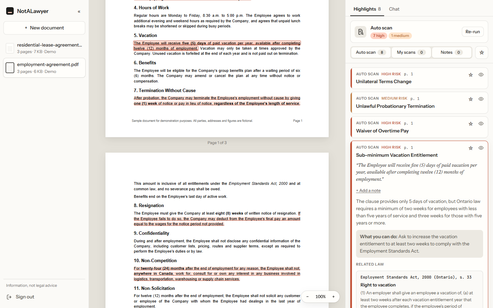
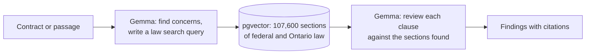

# NotALawyer

**Read the fine print before you sign.** Upload a contract and NotALawyer flags the clauses that work against you, explains them in plain language, and links each one to the exact section of Canadian law it runs into.



Built for the **AMD Developer Hackathon Act III** on AMD Token Factory. NotALawyer gives information, not legal advice.

## Features

- **Auto scan.** Reviews the whole contract for risky clauses (one-sided terms, waived rights, less than the law guarantees) and ranks them by risk.
- **Scan a passage.** Select any text to learn what it means, whether it's a problem, what to ask for instead, and which law applies.
- **Notes.** Highlight and annotate passages yourself, with no AI involved. Name, colour, star and filter every highlight.
- **Chat.** Ask about the contract. Answers quote the document and cite the law, and the chat can find, create, rename and scan highlights for you.
- **Exact citations.** Every citation opens the section itself on Justice Laws or Ontario's e-Laws, not just the law's front page.

## How it works



Each feature makes two calls to `Gemma-4-31B-IT` on AMD Token Factory, with a vector search in between:

1. The model reads the contract (or the selected passage) and, for each concern, writes a search query aimed at the legal rule behind it, such as "minimum annual vacation for employees in Ontario".
2. Each query is embedded with `BAAI/bge-small-en-v1.5` and matched against every section of the loaded law in Postgres with pgvector.
3. The model reviews each clause against the sections retrieved for it. It sees them under short refs and may cite only those; the backend drops any other citation, so a citation always points at real law in the database.

The scan, the passage check and the chat share the same review criteria, so a clause gets the same verdict from each.

## Tech stack

| Part | Technology |
| --- | --- |
| Frontend | React 19, Vite, react-pdf |
| Backend | FastAPI, SQLAlchemy, Alembic, pdfplumber, managed with [uv](https://docs.astral.sh/uv/) |
| Database | PostgreSQL with pgvector (HNSW cosine index), hosted on [Supabase](https://supabase.com) |
| LLM | `Gemma-4-31B-IT` on [AMD Token Factory](https://developer.amd.com.cn/radeon/api), an OpenAI-compatible API on AMD GPUs |
| Embeddings | `BAAI/bge-small-en-v1.5` with sentence-transformers, run by the backend |

## Getting started

### Prerequisites

- [uv](https://docs.astral.sh/uv/getting-started/installation/), which installs the Python version the backend needs (3.14)
- [Node.js](https://nodejs.org) 22 or newer
- A PostgreSQL database with the pgvector extension available. A free [Supabase](https://supabase.com) project works: copy its connection string from **Connect → Session pooler** (the direct connection needs IPv6).
- An AMD Token Factory API key

### 1. Backend

```bash
cd backend
uv sync
cp .env.example .env               # then fill it in, see Configuration
uv run alembic upgrade head        # creates the tables and enables pgvector
uv run python -m backend.seed      # loads the two demo contracts
uv run uvicorn backend.main:app --reload
```

The API runs at <http://localhost:8000>. `/health/db` checks the database connection, and `/docs` has interactive API docs.

### 2. Law database

A new database has no law in it, so scans find issues but cite nothing. Load it once:

```bash
cd backend
uv run python -m backend.ontario_laws     # Ontario law, a few minutes
uv run python -m backend.ingest_laws      # federal law, hours on a CPU
```

The federal loader downloads Justice Canada's XML (about 340 MB, into the git-ignored `backend/data/`). Both loaders are safe to re-run, and both stop once the database reaches 460 MiB, because Supabase's free tier turns read-only at 500 MB. See [Law database](#law-database).

### 3. Frontend

```bash
cd frontend
npm install
npm run dev
```

Open <http://localhost:5173> and enter the `ACCESS_CODE` from `backend/.env`.

## Configuration

The backend reads `backend/.env` ([example](backend/.env.example)):

| Variable | Required | Description |
| --- | --- | --- |
| `DATABASE_URL` | yes | PostgreSQL connection string |
| `TOKEN_FACTORY_API_KEY` | for AI features | AMD Token Factory key. Without it, scans and chat return `503`. |
| `ACCESS_CODE` | no | Passcode for entering the app. Empty turns the login off. |
| `JWT_SECRET` | in production | Signs login tokens. If empty, each restart picks a random one and signs everyone out. Generate one with `python -c "import secrets; print(secrets.token_urlsafe(32))"`. |
| `ACCESS_TOKEN_EXPIRE_MINUTES` | no | How long a login lasts. Default `720` (12 hours). |
| `CORS_ORIGINS` | no | Origins allowed to call the API, as a JSON list. Default `["http://localhost:5173"]`. |
| `STORAGE_DIR` | no | Where uploaded PDFs are saved. Default `storage`, relative to `backend/`. |
| `TOKEN_FACTORY_BASE_URL` | no | Default `https://developer.amd.com.cn/radeon/api/v1` |
| `TOKEN_FACTORY_MODEL` | no | Default `Gemma-4-31B-IT` |

The frontend reads `VITE_API_URL`, the backend's address, from `frontend/.env` when it builds ([example](frontend/.env.example)). Default `http://localhost:8000`.

Documents are shared by everyone who logs in. Highlights, notes, scan results and chats are saved in each browser.

## Law database

| Law | Laws | Sections | Source |
| --- | --- | --- | --- |
| Federal Acts | 895 | 55,446 | [Justice Laws XML](https://github.com/justicecanada/laws-lois-xml), Open Government Licence – Canada |
| Federal regulations | 2,429 | 48,215 | the same |
| Ontario statutes | 21 | 3,637 | [e-Laws](https://www.ontario.ca/laws), Ontario's official consolidated law |
| Ontario regulations | 3 | 317 | the same |

- **Ontario** covers the laws behind everyday contracts: jobs (Employment Standards Act, Human Rights Code), homes (Residential Tenancies Act, Condominium Act), buying and borrowing (Consumer Protection Act, Payday Loans Act, Sale of Goods Act, and more), and any contract (Limitations Act). The full list is `LAWS` in [`ontario_laws.py`](backend/src/backend/ontario_laws.py).
- **Federal** regulations from 1987 to 1999 (about 940) didn't fit under the size cap; everything from 2000 on is loaded.
- **Other provinces** aren't loaded yet. For their contracts the app says the province's law should be checked, and cites federal law only where it governs.

Each section is stored with its jurisdiction, and the model cites only law from the jurisdiction that governs the contract. To load a few laws instead of all of them:

```bash
uv run python -m backend.ingest_laws --only C-46        # federal, by Justice Laws file name
uv run python -m backend.ontario_laws 00e41             # an Ontario statute, by e-Laws name
uv run python -m backend.ontario_laws regulation/050017 # an Ontario regulation
```

Change the size cap with `--max-mb`. To try a search from the terminal:

```bash
uv run python -m backend.search_laws "can my landlord enter without notice"
```

## Deployment

`compose.yaml` runs the app on a server with Docker: Caddy serves the frontend over HTTPS and forwards the API to the backend, on one domain. [docs/deployment.md](docs/deployment.md) walks through setting up a fresh Ubuntu server.

```bash
echo "DOMAIN=your.domain.com" > .env    # and fill in backend/.env
docker compose up -d --build
```

## Development

```bash
cd backend && uv run pytest     # backend tests
cd frontend && npm run lint     # frontend lint
```

After changing [`models.py`](backend/src/backend/models.py), create a migration with `uv run alembic revision --autogenerate -m "describe the change"`, then apply it with `uv run alembic upgrade head`. The backend refuses to start against a database with migrations missing.

The [API reference](docs/api.md) explains each endpoint and how the scan, passage check and chat work.

### Project structure

```text
backend/
  src/backend/
    main.py              FastAPI app
    auth.py              access code and login tokens
    documents.py         upload, PDF storage, text extraction (pdf_text.py)
    loopholes.py         auto scan
    explain.py           scan of a selected passage
    chat.py              document chat; chat_items.py checks the changes it asks for
    review_criteria.py   prompt wording the three share
    laws.py              law parsing, embeddings and vector search
    law_citations.py     limits citations to the sections retrieved
    highlights.py        finds quoted text on the PDF's pages
    llm.py               AMD Token Factory client
    ingest_laws.py       loads federal law
    ontario_laws.py      loads Ontario law
    seed.py              loads the demo contracts
  Dockerfile
  migrations/            Alembic migrations
  sample_documents/      demo contracts (fictional)
  tests/
frontend/
  src/
    api/                 backend client
    components/          sidebar, PDF viewer, highlights list, chat
    hooks/               scan, highlights and chat state, saved in the browser
    utils/
  Caddyfile              web server: HTTPS, the app, and the API passed to the backend
  Dockerfile
docs/
  api.md                 API reference
  deployment.md          running it on a server
compose.yaml             production: backend and web server
```
